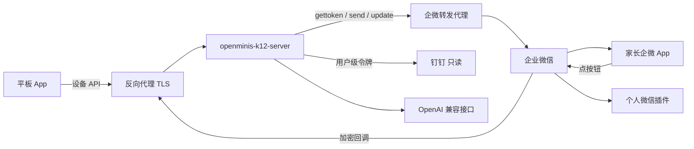
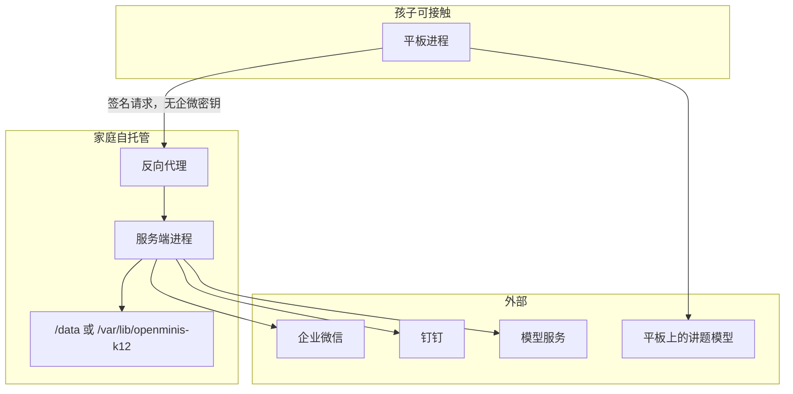
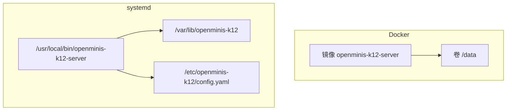
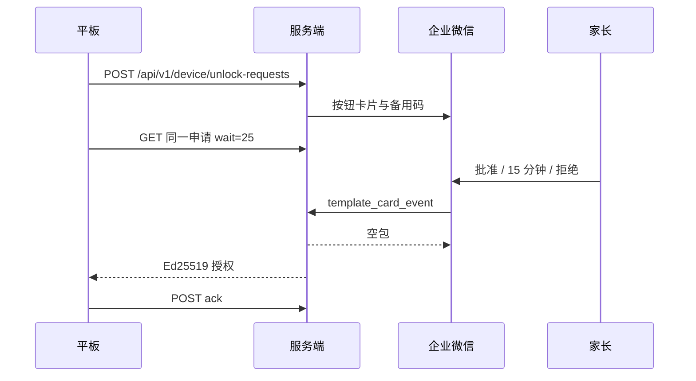
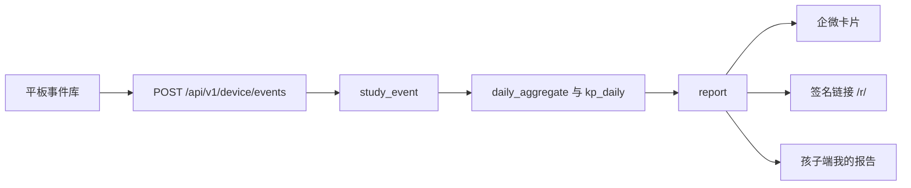

# 架构

r16 基线。组件边界以本文为准；模块内部见 `modules/`。

## 上下文

一个家庭自托管。v1 数据模型带 `family_id`，运行时只有一个家庭。不替其他家庭代收企业微信（可信 IP 不能填第三方），其他家庭用同一份镜像自己部署。

平板上的讲题仍走上游 Minis 模型层。服务端另有一个 OpenAI 兼容小模型，只做通知抽取、报告文字、亲子建议改写，Key 不下发平板。

不做定位或行踪。平板不直连企业微信，不登录钉钉。

## 组件

| 组件 | 职责 | 不做什么 |
| --- | --- | --- |
| 平板 App | 儿童主页、技能、揭晓状态机、本机 PIN/TOTP、事件、练习 | 不持有企微密钥；不向家长展示聊天原文；v1 不在平板上做家长报告页 |
| OpenMinis-K12 服务端 | 配对、解锁状态机、企微、报告、配置、备份密文、管理界面 | 不讲题；不解密平板备份；不向班级群发消息 |
| 企微转发代理 | 把出站 API 从固定公网 IPv4 发出；模式 B 下把回调转进服务端 | 不持有业务状态。路径白名单见下 |
| 企业微信自建应用 | 模板卡片与按钮回调 | 与家中其他应用分 AgentId / Secret / 回调路径 |
| 钉钉 | v1.2，家长在管理页扫码一次 | 只读老师/管理员消息 |
| 上游模型层 | 家长在平板按 Minis 原方式配置 | 本项目不改供应商实现，只加 PIN 门 |

模式 B（已选定）：服务端在家中常开主机，出站 API 基址指向转发代理（默认 `https://qyapi.weixin.qq.com`，配置成代理地址）。回调沿用已在用的外网入口，增加专用路径。模式 A（服务端与代理同机）不采用。

代理只放行：`/cgi-bin/gettoken`、`/cgi-bin/message/send`、`/cgi-bin/message/update_template_card`，可选 `/cgi-bin/getcallbackip`。只接受服务端来源。MoviePilot 一类菜单代理示例若未包含 `update_template_card`，需要补白名单。

## 信任边界

| 秘密 | 位置 |
| --- | --- |
| corpid、应用 Secret、Token、EncodingAESKey、钉钉令牌、服务端模型 Key | 只在服务端，主密钥 AES-256-GCM。主密钥来自环境变量或 `/data/master.key`（权限 600），不进备份文件本体 |
| 服务端 Ed25519 签名私钥 | 只在服务端；公钥配对时写入平板 |
| 设备私钥、`codeSecret`、TOTP、家长 PIN 哈希、讲题模型 Key | 平板。设备私钥与 `codeSecret`、TOTP 在 Android Keystore。PIN 只存加盐哈希 |
| 备份口令 | 只在家长手里。服务端只存密文 |
| 告警片段 | 服务端加密，30 天，仅管理登录后可看。不进企微、不进大模型、设备接口不下发 |

两个监听端口，进程内都是明文 HTTP，TLS 在反向代理终结：

| 端口 | 暴露 | 不暴露 |
| --- | --- | --- |
| 公网 | `/api/v1/device/*`、`/wecom/callback/*`、`/r/*` | 管理路径返回 404（R7） |
| 管理 | Web UI、`/api/v1/admin/*` | 不直接映射到公网，只经反向代理 |

不提供合并成单端口的模式。端口号见 T-27。`trusted_proxies` 之外的 `X-Forwarded-*` 忽略。

## 部署

两种部署都要能在全新主机上约 10 分钟内走完安装向导（R1）。升级时先自动备份再迁移。

| 项 | Docker | systemd |
| --- | --- | --- |
| 镜像 / 单元 | 多阶段：Node 构建前端 → Go 编译 → distroless static nonroot | `openminis-k12-server.service`；`NoNewPrivileges`、`ProtectSystem=strict`、`PrivateTmp` |
| 用户 | 非 root | 专用系统用户 |
| 健康检查 | 二进制子命令 `healthcheck`（镜像内无 curl） | 同左 |
| 配置 | YAML + `OPENMINIS_K12_*` 覆盖；业务配置在库里 | 同左，文件 `/etc/openminis-k12/config.yaml` |
| 反向代理 | 公网端口与管理端口分开映射，绑定本机或内网 | 同左 |

本家用哪一种见 T-14。产物：`linux/amd64` 与 `linux/arm64`，`CGO_ENABLED=0`。SQLite 用 `modernc.org/sqlite`，WAL。

## 数据流

### 解锁

中继不可达时平板 5 秒内改走 PIN / TOTP，解锁申请不排队。10 分钟无人处理则过期。告警与报告在平板排队，恢复后补发并标注延迟。细节见 `modules/unlock.md`。

### 学习事件到报告

日界按家庭时区（默认 `Asia/Shanghai`）与日界时刻（建议 04:00，T-12），不按设备时区。设备时钟用心跳校正，偏差超过 2 分钟则修正 `occurred_at` 并记日志。

亲子建议只出现在家长侧卡片与网页。设备接口在服务端去掉 `parent_advice_json`。

### 钉钉（v1.2，钉钉-D1–D4 之后）

家长在管理页扫码 → 服务端持令牌 → 按孩子绑定的群拉取 → 丢掉非老师消息 → 抽取 → 平板 `GET /api/v1/device/tasks`。平板不回写钉钉。失败时拍照/截图进入同一任务列表。

## 与上游进程的关系

K12 壳层包住现有 `MainActivity` / `NavHost`，不替换 Agent 循环。技能文件注入教法；揭晓由壳层状态机决定。挂钩清单见 `upstream-patches.md`。

平板周期任务用 WorkManager。只有时长管控或专注计时在进行时才用前台服务。讲题模型流量仍走上游网络栈；访问服务端用 `NetworkHttp` 派生的 OkHttp 客户端，校验证书指纹。
